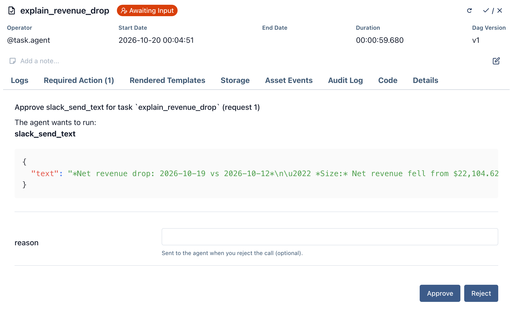
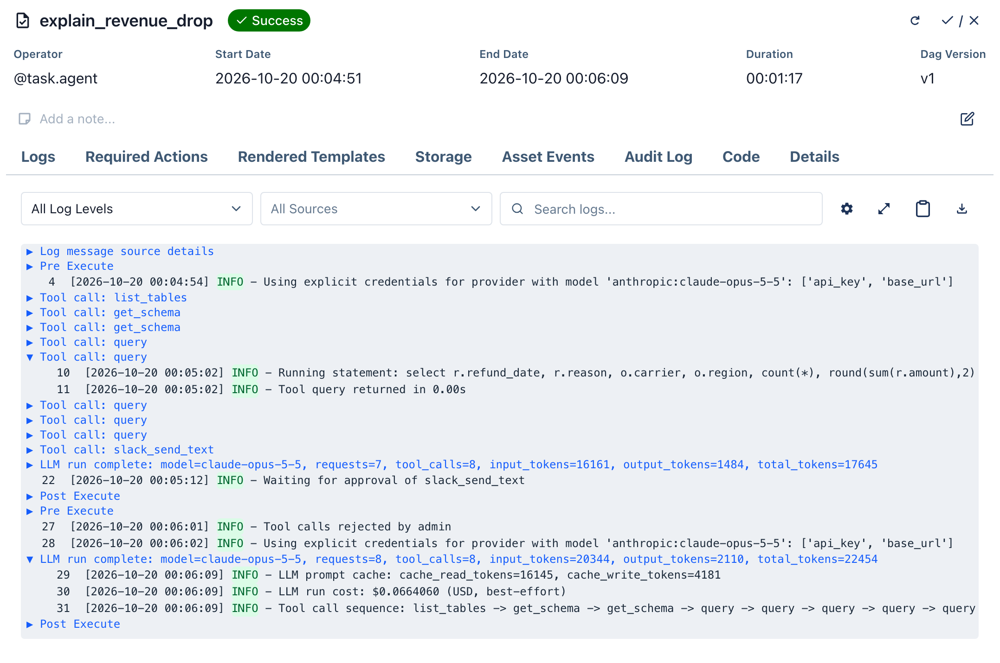
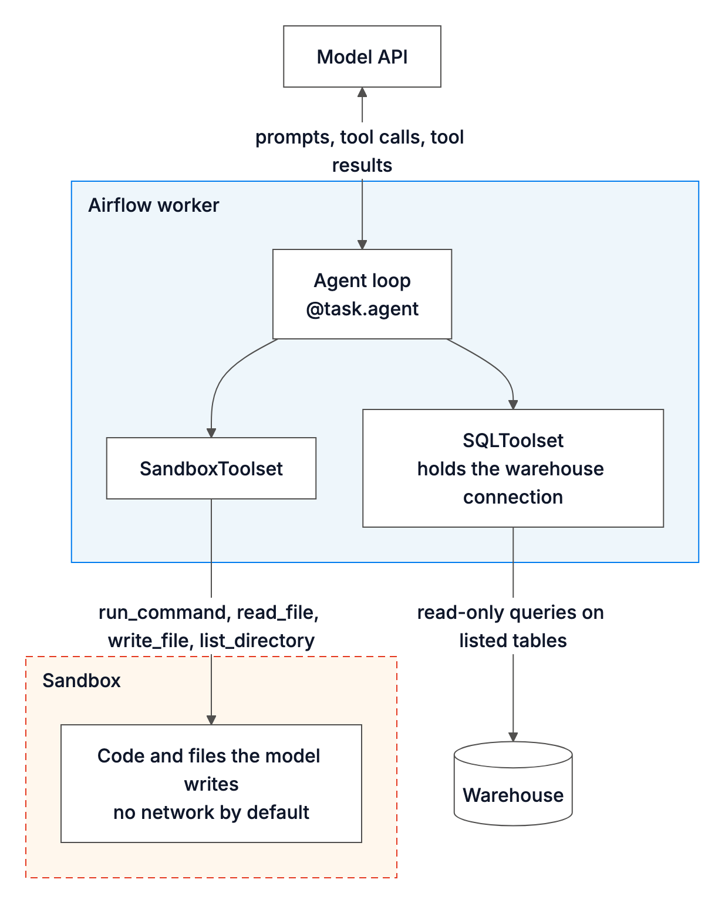

Common AI (`apache-airflow-providers-common-ai`), the Apache Airflow provider for LLMs and AI agents, is now 1.0. An agent in your pipeline can query your warehouse through read-only tools, run the code it writes in a sandbox rather than in the process that runs the task, and, on Airflow 3.3, wait for a person to approve a tool call before it acts.

Airflow is the open-source platform that schedules and runs data pipelines written in Python. A pipeline is a Dag, each step in it is a task, and a provider is a package that adds integrations to Airflow, in this case with model vendors and agent frameworks. An agent is a model working in a loop: it calls tools, the functions the Dag author allows it to use, such as a SQL query, reads each result and picks its next step until it has an answer. [The April post](/blog/common-ai-provider/) introduced the provider at 0.1.0.

1.0 is also the first release that installs on Airflow 2.11. Airflow 2 is past its end of life, but teams still on it can start using AI in their pipelines now and upgrade on their own schedule. The examples below use Airflow 3 imports, and [the 2.11 section](#on-airflow-211) lists what to change.

```bash
uv pip install "apache-airflow-providers-common-ai[anthropic,sql]"
```

Pick the extra for your model vendor: `openai`, `anthropic`, `google` or `bedrock`. The `sql` extra brings what `SQLToolset` and the `common.sql` operators need, and most of the examples below use it. The provider needs Airflow 2.11 or later and Python 3.11 or later. Every example below except the Anthropic SDK one calls the model through an Airflow connection of type `pydanticai` with the id `pydanticai_default`, which holds the API key and names the model, such as `anthropic:claude-opus-5-5`. The [quickstart](https://airflow.apache.org/docs/apache-airflow-providers-common-ai/stable/quickstart.html) creates it with one environment variable and runs a first task.

## An agent that asks before it posts to Slack

This Dag explains a drop in revenue, and needs Airflow 3.3 for the pause before the Slack call. Its one task is a Python function decorated with `@task.agent`: the function returns the request, `system_prompt` holds the standing instructions, and the decorator runs the agent and pushes its final answer to XCom, Airflow's store for small values passed between tasks. The agent gets two toolsets, each a group of tools: SQL over two tables of a warehouse, and a single Slack method that waits for a person every time the agent calls it.

```python
from __future__ import annotations

from datetime import datetime, timedelta

from airflow.providers.common.ai.toolsets.hook import HookToolset
from airflow.providers.common.ai.toolsets.sql import SQLToolset
from airflow.providers.slack.hooks.slack_webhook import SlackWebhookHook
from airflow.sdk import dag, task

# Read-only SQL over two tables. Queries that touch any other table are refused.
warehouse = SQLToolset(db_conn_id="warehouse", allowed_tables=["orders", "refunds"])

# One Slack method as a tool, and every call to it waits for a person's yes.
slack = HookToolset(
    SlackWebhookHook(slack_webhook_conn_id="slack_revenue"),
    allowed_methods=["send_text"],
    tool_prefix="slack",
).approval_required()


@dag(schedule="@daily", start_date=datetime(2026, 10, 1), catchup=False)
def revenue_drop():
    @task.agent(
        llm_conn_id="pydanticai_default",
        system_prompt=(
            "You are a revenue analyst. Use SQL to find what changed, then post a short "
            "summary to Slack: the size of the drop, the cause, and the evidence."
        ),
        toolsets=[warehouse, slack],
        tool_approval_timeout=timedelta(hours=4),
    )
    def explain_revenue_drop(ds=None):
        return f"Net revenue on {ds} fell compared with the week before. Find out why."

    explain_revenue_drop()


revenue_drop()
```

`SQLToolset` refuses write statements by default. With `allowed_tables` set, the agent can list, describe and query only `orders` and `refunds`: each query is parsed before it runs, and one that reaches another table, including through a subquery, a CTE, a JOIN or `information_schema`, is refused and handed back to the agent as an error. `COPY` and inline comments are refused too, and so is any function the SQL parser does not recognize, unless you list it in `allowed_functions`. The seeded warehouse also has a `customers` table with names and email addresses. With the toolset above, `list_tables` returned only `["orders", "refunds"]`, and a direct call of the `query` tool with `SELECT name, email FROM customers LIMIT 3` came back with this error, the first of its two lines:

```text
The query tool failed: Query references tables that are not in the allowed tables list: customers. Use list_tables to see the allowed tables.
```

The [security docs](https://airflow.apache.org/docs/apache-airflow-providers-common-ai/stable/agent_security.html) call this an application-level guardrail rather than a security boundary, and ask you to point the connection at a database role that can read only those tables. `HookToolset` turns the `send_text` method of Airflow's Slack webhook hook into a tool, and `.approval_required()` marks every call to it. The Dag also needs the Slack provider, `apache-airflow-providers-slack`, and this SQLite warehouse needs `apache-airflow-providers-sqlite`.

We ran the Dag on Airflow 3.3.2 against a small SQLite warehouse that we seeded by hand: eight days of orders, and on 19 October a burst of "damaged in transit" refunds on EU orders shipped by one carrier, ParcelOne. The model was Claude Opus 5.5. We ran the Dag six times, and each run found the same cause with three to five queries. In the run shown here, the agent listed the tables, read both schemas, ran five queries and asked to post. The task stopped and the request appeared on the task's **Required Actions** tab:



The box holds the arguments of the call. These are two of the four bullets in the message the agent wanted to post, unedited:

```text
*Net revenue drop: 2026-10-19 vs 2026-10-12*
• *Size:* Net revenue fell from $22,104.62 to $20,585.59, down *$1,519 (−6.9%)*.
• *Cause:* A spike in *"damaged in transit" refunds on ParcelOne EU orders*. Gross sales did not fall.
```

We checked the message's figures against the seeded tables, and all but one match: it puts refunds for other reasons at about $500, where they came to $425. While it waits, the task is in the `awaiting_input` state, holds no worker slot, and keeps the conversation so far in the task state store. **Approve** runs the call. **Reject** does not fail the task: the agent is told the call was denied and carries on. A reason the reviewer types reaches the agent verbatim, in place of the tool's result, so write it as a note the agent can act on. We rejected the post with "Rejected by the reviewer: we post a cause only after the carrier confirms it. Return the summary instead." As the reason asked, the agent returned the summary instead of posting, and its answer opened like this:

```text
I didn't post the summary to Slack. The reviewer rejected it because a cause only goes out after the carrier confirms it, and ParcelOne hasn't confirmed anything yet. Here's what I found.

[…]

**Likely cause (not yet confirmed by the carrier):** A spike in "damaged in transit" refunds on ParcelOne orders in the EU. Sales held up; refunds caused the drop.
```

As in April, the task log keeps every tool call in its own collapsible group, now with the SQL each query ran, and a summary line after each part of the run: model requests, tool calls, tokens, cached tokens and an estimated cost. For this run the estimate was $0.07 across eight model requests, with most of the input tokens read from the prompt cache. The estimate comes from a price table and is not the vendor's bill.



Tool approval that pauses the task needs Airflow 3.3. On Airflow 2.11 to 3.2, a call to a marked tool fails the task instead. It also cannot be combined with `durable=True`, `enable_hitl_review` or a `SandboxToolset` that starts its own sandbox: with any of them, a call to a marked tool fails the task. Under a `CodeMode` capability, a marked tool called from `run_code` does not run, and the model is told so and carries on. On 3.3 a task instance can ask for approval once per Dag run, retries and clears included, and a second request fails the task without retrying. In the upcoming Airflow 3.4, each step that calls a marked tool can pause the task again, and a retry asks again even for calls a reviewer approved in an earlier attempt, so keep gated tools idempotent. `tool_approval_timeout` fails the task if nobody answers within four hours, or rejects the call with `on_tool_approval_timeout="deny"`. The [tool approval guide](https://airflow.apache.org/docs/apache-airflow-providers-common-ai/stable/tool_approval.html) covers who may decide.

The upcoming Airflow 3.4 adds task loops, which repeat a group of tasks until a condition holds. In this recording, which Ash Berlin-Taylor made on a development build, an `@task.llm` task writes a draft, a person reviews it through `HITLOperator`, and the group runs again with the feedback until the reviewer approves, up to five times. The reviewer asked for emoji, and the second draft had them. The video is cropped and plays at twice the speed.

<video controls muted playsinline preload="metadata" poster="images/loops-demo-poster.jpg" width="100%">
  <source src="images/loops-demo.mp4" type="video/mp4">
</video>

## Let a model decide whether a failed task retries

On Airflow 3.3, every operator takes a `retry_policy`: after a failure, it decides whether the task retries, after how long, or fails at once. The provider's two policies hand that decision to a model, so they work on any task, not only AI ones. This Dag has two ordinary tasks that fail on purpose, one with a revoked key and one with a rate limit on its first try:

```python
from __future__ import annotations

from airflow.providers.common.ai.policies.retry import LLMRetryPolicy
from airflow.sdk import dag, get_current_context, task

# A model reads each failure, names its category, and decides: retry after a delay, or fail now.
policy = LLMRetryPolicy(llm_conn_id="pydanticai_default")


@dag(schedule=None)
def nightly_export():
    @task(retries=3, retry_policy=policy)
    def upload_with_revoked_key():
        raise PermissionError("403 Forbidden: the access key for bucket exports-eu was revoked")

    @task(retries=3, retry_policy=policy)
    def upload_during_throttling():
        if get_current_context()["ti"].try_number == 1:
            raise RuntimeError("429 Too Many Requests: upload quota exceeded, slow down")
        return "uploaded"

    upload_with_revoked_key()
    upload_during_throttling()


nightly_export()
```

`LLMRetryPolicy` sends the exception's class and message to the model, with any secrets Airflow has registered masked first, and the model names a category, decides and says why. On Airflow 3.3.2 with Claude Opus 5.5, the two task logs recorded these decisions:

```text
Retry policy decision  action=fail   reason='auth: A 403 Forbidden caused by a revoked access key is an authentication failure. Retrying will not help because the credentials must be rotated or replaced, so this should not be retried.'
Retry policy decision  action=retry  reason="rate_limit: HTTP 429 Too Many Requests with an 'upload quota exceeded, slow down' message is API throttling. The request should succeed once the quota window resets, so retry after a 60-second delay. This is attempt 1 of 4, so retries remain."
```

The task with the revoked key failed on its first try instead of using its three retries, and the throttled task ran again 60 seconds later and succeeded. A decision to retry is also written to the task instance's `retry_reason`. If the model call itself fails, the policy falls back to its `fallback_rules`, exception-type rules that need no model, or to the task's normal retry behavior when none are set.

`LLMRetryPolicy`, shown above, lets a text model reason from your instructions. `ClassifierRetryPolicy` has the model pick one of your categories instead, and each category sets whether to retry and after how long, so the model never chooses the delay. Under both sits the Task SDK's `ExceptionRetryPolicy`, which matches exception types with no model. `fallback_policy` puts an `LLMRetryPolicy` behind a classifier for the failures the classifier is unsure of (below `min_confidence`) or cannot classify at all. Both provider policies are stable.

`ClassifierRetryPolicy` is also the policy for decision models, which answer a typed question with one value from a fixed set plus a confidence, and you can set the minimum confidence each category needs. Decision models come from any server that speaks the System One API, such as Ollama, Strands Decider or the open-weight Kev, or from TypeSafe's hosted Jev through the experimental `typesafe` extra. The [retry policies guide](https://airflow.apache.org/docs/apache-airflow-providers-common-ai/stable/retry_policies.html) covers categories, confidence and how the policies chain.

## What changed since April

Counted from the release tags:

| | 0.1.0 (April) | 1.0.0 (October) |
|---|---|---|
| Operators | 6 | 10, adding batch prompts, document loading, and LlamaIndex embedding and retrieval |
| Toolsets | 5 | 9, adding object storage, Agent Skills, sandboxes and managed agents |
| Agent frameworks | Pydantic AI | Pydantic AI, Strands Agents, Google ADK, the Anthropic SDK tool runner, the OpenAI Agents SDK and LangChain |
| Sandbox backends | none | 6 |
| Connection types | 4, plus MCP | 6, plus MCP, adding LangChain and LlamaIndex |
| Use-case pages in the docs | none | 10 |
| Oldest supported Airflow | 3.0 | 2.11 |

The registry counts `LoggingToolset`, a wrapper that logs another toolset's calls, as a toolset, and both counts here include it. The April post covered the decorators, `HookToolset`, MCP, output review and `durable=True`, and Vikram Koka's posts on [agentic workloads](/blog/agentic-workloads-airflow-3/) and [survey analysis pipelines](/blog/ai-survey-analysis-pipelines/) built full pipelines from the LLM operators.

## Tools and a workspace for the agent

Besides SQL and hooks, `ObjectStorageToolset` lets an agent list and read files under one object-storage path, and it cannot write. `pinned_arguments` on `HookToolset` fixes an argument, such as a bucket name, so the model never sees it, and a call that tries to set it is refused with a note that the argument is fixed. `.defer_loading()` on any toolset hides its tools until the model searches for them, so a wide toolset costs input tokens mostly for the tools a run looks for. `ManagedAgentToolset` gives the agent one tool that sends a prompt to an agent running on a cloud vendor's infrastructure. Amazon Bedrock AgentCore and Vertex AI Agent Engine support it, through the `common.ai` extra of the Amazon and Google providers.

### Tools from MCP servers and Agent Skills

MCP servers expose tools to models over the Model Context Protocol, and `MCPToolset` connects an agent to one through an Airflow connection. New since April, `token_provider` takes a function that returns a bearer token, so a server that needs a short-lived token, such as a freshly minted Snowflake JWT, gets one when the toolset first connects instead of a static password. `env_provider` does the same for a local stdio server's environment when its secret lives in another Airflow connection, and registers every value it returns with the secret masker. Both run in Dag code when the task runs, so the secret never lands in the serialized Dag. `.filtered()` offers the model only the tools you choose. `MCPToolset` and `MCPHook` are stable.

`AgentSkillsToolset` gives an agent a library of [Agent Skills](https://agentskills.io), `SKILL.md` bundles of instructions and, optionally, scripts and resources. Only the skill names and descriptions sit in the prompt, and the model loads a skill when it needs one. This task gives an agent the provider's example `sql-reporting` skill, a page of SQL conventions, next to the warehouse:

```python
from __future__ import annotations

from airflow.providers.common.ai.toolsets.skills import AgentSkillsToolset
from airflow.providers.common.ai.toolsets.sql import SQLToolset
from airflow.sdk import dag, task


@dag(schedule=None)
def refunds_with_skills():
    @task.agent(
        llm_conn_id="pydanticai_default",
        system_prompt="You are a data analyst. Consult your skills before writing SQL.",
        toolsets=[
            # A directory of SKILL.md bundles. GitSkills(repo_url=..., conn_id=...) loads them from Git.
            AgentSkillsToolset(sources=["/opt/airflow/skills"], exclude_tools={"run_skill_script"}),
            SQLToolset(db_conn_id="warehouse", allowed_tables=["orders", "refunds"]),
        ],
    )
    def refund_rate_by_carrier():
        return "Which carrier had the highest refund rate on 2026-10-19?"

    refund_rate_by_carrier()


refunds_with_skills()
```

On Airflow 3.3.2, the agent's first tool call was `load_skill`. Its queries used explicit columns, a date filter and snake_case aliases, as the skill asks, and it found ParcelOne's 30 refunds on 59 orders. A source can also be `GitSkills`, a repository cloned on the worker when the run starts, with credentials from an Airflow `git` connection: the token never reaches the serialized Dag, a plain `http://` URL with a connection is refused, and the clone is removed when the run ends. Skill scripts run on the worker through the `run_skill_script` tool, which is why the example excludes it. Agent Skills are experimental and need Airflow 3.0, which the `skills` extra requires.

### A sandbox for the code the model writes

`SandboxToolset` gives the agent a shell and a filesystem in a sandbox, with four tools: `run_command`, `read_file`, `write_file` and `list_directory`. This Dag pulls rows with SQL and has the agent compute refund rates in Python inside the sandbox. It uses the local Docker Sandboxes backend, which needs the `sbx` CLI, a Docker login (`sbx login`) and a host network policy set once with `sbx policy init deny-all`.

```python
from __future__ import annotations

from airflow.providers.common.ai.sandbox import SbxSandboxBackend
from airflow.providers.common.ai.toolsets import SandboxToolset
from airflow.providers.common.ai.toolsets.sql import SQLToolset
from airflow.sdk import dag, task


@dag(schedule=None)
def refund_rates():
    @task.agent(
        llm_conn_id="pydanticai_default",
        system_prompt=(
            "Pull order and refund rows with SQL, write them into the sandbox as CSV, and compute "
            "the numbers there with Python rather than in your head. The sandbox has no network."
        ),
        toolsets=[
            SQLToolset(db_conn_id="warehouse", allowed_tables=["orders", "refunds"]),
            # Code the model writes runs in a local microVM; this host's sbx policy denies all network access.
            SandboxToolset(SbxSandboxBackend(host_network_policy="deny-all")),
        ],
    )
    def compare():
        return "Compare the refund rate by carrier and region on 2026-10-19 with the week before."

    compare()


refund_rates()
```

On the same warehouse and Airflow 3.3.2, the agent made ten query calls. The toolset refused one of them before it ran, because it used `julianday`, a function the parser cannot check against `allowed_tables`. The agent then ran three commands in the sandbox that wrote the rows to two CSV files and computed the rates. It reported that ParcelOne in the EU refunded 30 of its 59 orders on 19 October (50.85%), against 2.97% across 12 to 18 October (13 of 438 orders). The run read 210,921 input tokens over 13 model requests, an estimated $0.45, because every row the agent moves into the sandbox passes through the model's context, and that context goes out again with each request.



A sandbox denies network access by default and gets nothing from Airflow except what its `SandboxSpec`, the sandbox's settings, names. A backend that cannot enforce a setting refuses it rather than ignoring it. For `sbx`, the network rule lives in the host policy: `host_network_policy="deny-all"` declares that the policy is in place, and the backend takes that on trust rather than checking it. The sandbox contains the code the model writes and runs, not the agent: the agent loop and every other toolset still run in the worker with the worker's credentials. The toolset destroys the sandbox when the run ends, but if the worker is killed outright, an `sbx` microVM and its workspace are left behind under an `airflow-sandbox-*` name.

Six backends ship: Modal, Boat and Islo are hosted, OpenSandbox and OpenShell are self-hosted, and Docker Sandboxes (`sbx`), used above, is for local development. The sandbox and its backends are experimental, and the [backend guide](https://airflow.apache.org/docs/apache-airflow-providers-common-ai/stable/sandbox/backends.html) compares them on CPU, egress rules and timeouts. The Modal backend needs Airflow 3.

## Keep the agent framework you already use

The provider's own operators are built on Pydantic AI, but an agent written in another framework can run in a plain `@task` and still use Airflow's toolsets. This task hands `SQLToolset` to the Anthropic SDK's tool runner, with the loop left as the SDK's own. It reads the API key, and a base URL if you route through one, from an Airflow connection named `anthropic_llm`. We ran it on Airflow 3.3.2; importing `BaseHook` from `airflow.sdk` needs Airflow 3.1 or later, and older versions import it from `airflow.hooks.base`.

```python
from __future__ import annotations

from anthropic import Anthropic

from airflow.providers.common.ai.tools.anthropic import AirflowTools
from airflow.providers.common.ai.toolsets.sql import SQLToolset
from airflow.sdk import BaseHook, dag, task


@dag(schedule=None)
def refunds_by_carrier():
    @task
    def ask() -> str:
        conn = BaseHook.get_connection("anthropic_llm")
        client = Anthropic(api_key=conn.password, base_url=conn.host or None)
        tools = AirflowTools(SQLToolset(db_conn_id="warehouse", allowed_tables=["orders", "refunds"]))
        runner = client.beta.messages.tool_runner(
            model="claude-opus-5-5",
            max_tokens=4000,
            max_iterations=10,
            tools=tools.tools,
            messages=[{"role": "user", "content": "Which carrier had the most refunds on 2026-10-19?"}],
        )
        message = tools.run(runner)
        return "".join(block.text for block in message.content if block.type == "text")

    ask()


refunds_by_carrier()
```

It made six tool calls and answered "ParcelOne had the most refunds on 2026-10-19, with 30 of the day's 36." Each tool keeps the toolset's checks, such as `allowed_tables`, its results are masked, and each call gets its own group in the task log. The same adapters exist for Strands Agents, Google ADK and the OpenAI Agents SDK, and LangChain gets a model hook and a converter from any toolset to LangChain tools. The adapters are experimental, and tool approval and output review run only on the provider's own operators. The framework-neutral tool interface they are written against (`AirflowTool`, `ToolResult` and `ToolCallError`) is stable, so a framework that is not on the list can use it too. The [frameworks guide](https://airflow.apache.org/docs/apache-airflow-providers-common-ai/stable/frameworks/index.html) shows what Airflow takes on for each one.

The model stays a connection setting, as in April. New since then, `fallback_conn_ids` on a connection lists others to try when a vendor is down, and the next one continues the run within the same task attempt.

## Retries that pick up where the last attempt stopped

[The April post](/blog/common-ai-provider/) introduced `durable=True`. In 1.0 it is built on `AirflowDurability`, a capability that also works on an agent you build yourself in a plain `@task`. It records each step the agent completes in a journal kept for the task instance. A retry replays the recorded steps instead of running them again, until it reaches the first step whose request no longer matches, and from there the run goes live. Nothing in that depends on Airflow: a scheduler that keeps a journal per task and matches it step by step on each retry gets the same behavior. Here it is on a Pydantic AI agent built by hand, with a report tool that raises on the first try to stand in for an outage:

```python
from __future__ import annotations

from datetime import timedelta

from pydantic_ai import FunctionToolset

from airflow.providers.common.ai.durable import AirflowDurability
from airflow.providers.common.ai.hooks.pydantic_ai import PydanticAIHook
from airflow.providers.common.ai.toolsets.sql import SQLToolset
from airflow.sdk import dag, get_current_context, task


def save_report(text: str) -> str:
    """Save the finished report."""
    if get_current_context()["ti"].try_number == 1:
        raise ConnectionError("report store unavailable")  # A simulated outage on the first try.
    return "saved"


@dag(schedule=None, default_args={"retries": 1, "retry_delay": timedelta(seconds=10)})
def refund_report():
    @task
    def analyze() -> str:
        agent = PydanticAIHook(llm_conn_id="pydanticai_default").create_agent(
            name="refund_analyst",
            instructions="Use SQL to find which carrier and region drove refunds, then save a three-line report.",
            toolsets=[
                SQLToolset(db_conn_id="warehouse", allowed_tables=["orders", "refunds"]),
                FunctionToolset([save_report], id="reports"),
            ],
            capabilities=[AirflowDurability()],
        )
        return agent.run_sync("Write the refund report for 2026-10-19.").output

    analyze()


refund_report()
```

The first try made six model requests and seven SQL tool calls, then failed on `save_report`. With `[logging] namespace_levels = task=DEBUG`, the second try's log shows the journal at work (timestamps, log prefixes and positions 2 to 11 trimmed):

```text
[debug] Durable: replayed step   position=0   step=refund_analyst__model.request
[debug] Durable: replayed step   position=1   step=refund_analyst__airflow_toolset__sql-warehouse.call_tool:list_tables
...
[debug] Durable: replayed step   position=12  step=refund_analyst__model.request
[debug] Durable: recorded step   position=13  step=refund_analyst__function_toolset__reports.call_tool:save_report
[debug] Durable: recorded step   position=14  step=refund_analyst__model.request
```

All 13 recorded steps replayed in about 50 milliseconds and no SQL ran against the warehouse. Only the failed tool call and the model request after it ran live. Each recorded step carries a fingerprint of its request. If the retry reaches a step that differs, because the prompt, a tool's definition or the conversation changed, that step and every step after it run live, and the log says so. Replay records results, not effects: a tool that acts and then raises, or whose worker dies before its result is recorded, runs again on the retry, so tools with side effects still need to be idempotent.

On Airflow 3.3 and later the journal lives in the task state store with no configuration; before 3.3, set `[common.ai] durable_cache_path` to an object-storage path. `durable=True` on `@task.agent` attaches the same capability, and combining it with a `SandboxToolset` fails when the Dag is parsed. Strands and OpenAI Agents SDK agents have experimental equivalents, `invoke_durably` and `run_durably`.

On Airflow 3.3, `usage_limits` counts usage across every attempt of a task, so a retry cannot reset its limits. That includes `cost_limit`, which caps a task's estimated spend in US dollars: it is checked after each response, so the call that crosses the limit is still billed, and a model with no known price is not capped.

## Batch prompts at about half the price

`@task.llm_batch` and `LLMBatchOperator` send many prompts through the OpenAI or Anthropic batch API, at about half the per-token price of one call per prompt, with up to a 24-hour turnaround. Results land as JSONL in object storage rather than XCom, and a retry re-attaches to the batch already submitted, as long as its inputs have not changed, instead of paying for it again. On Airflow 3.3, clearing a deferred batch task cancels the batch unless you set `cancel_on_kill=False`; the [operator guide](https://airflow.apache.org/docs/apache-airflow-providers-common-ai/stable/operators/llm_batch.html) lists the other cases that submit a new batch. The [classify reviews in bulk](https://airflow.apache.org/docs/apache-airflow-providers-common-ai/stable/use_cases/classify_reviews_in_bulk.html) page waits for its batch in deferrable mode, without holding a worker.

## Seeing what an agent did

`@task.agent` and `AgentOperator` write the log groups shown above and push their token usage and the name of the model that answered to XCom; the framework adapters write the same tool-call groups. Tool results pass through Airflow's secret masker before the model sees them. It knows only registered secrets, such as connection passwords, so a credential stored in the data itself gets through. With Airflow's tracing turned on (`[traces] otel_on`) and `[common.ai] otel_export_enabled = True`, the provider emits OpenTelemetry GenAI spans for each model and tool call through the exporter Airflow already uses. Tracing is experimental. The upcoming Airflow 3.4 adds an **AI Model** tab to the task instance page, showing the model, token usage and estimated cost.

## Running an agent you don't fully trust

**Fences** limit what the agent can reach. A toolset exposes what the Dag author configures: the hook methods in `allowed_methods`, one root path for object storage, and the tables in `allowed_tables` when it is set (without it, `SQLToolset` exposes every table). An MCP server's tools do whatever the server does, so choose servers you trust and use `.filtered()`. These are guardrails in the application, not a security boundary. Credentials stay in Airflow connections, held by the hooks in the worker; the model gets the results of the operations it calls, with registered secrets masked. When the agent has a sandbox, the code the model writes runs there.

**Gates** put a person in front of the steps that matter. Tool approval (Airflow 3.3) stops before a marked tool runs, and output approval, `require_approval` on the LLM operators (Airflow 3.1), holds an answer until someone approves or edits it. Both ask on the Required Actions page and can each be limited to named reviewers. Human-in-the-loop (HITL) review of an agent's answer, `enable_hitl_review` (Airflow 3.1), runs as a chat on the task instance page.

**Cameras** record what happened: tool-call log groups, usage on XCom, tracing, and Airflow's own task history, retries and audit log.

Access is still decided by the database role behind a connection, the network around a worker and the permissions of the identity the worker runs as. The [agent security guide](https://airflow.apache.org/docs/apache-airflow-providers-common-ai/stable/agent_security.html) ends with a checklist for production.

## Where to start

The [use-case pages](https://airflow.apache.org/docs/apache-airflow-providers-common-ai/stable/use_cases/index.html) start from jobs a data team already has. Each shows a Dag that ships with the provider:

| If you have | Start with |
|---|---|
| A queue of support tickets someone reads and routes by hand | [Triage support tickets](https://airflow.apache.org/docs/apache-airflow-providers-common-ai/stable/use_cases/triage_support_tickets.html) |
| Loads that break when a source schema changes | [Block a load on schema drift](https://airflow.apache.org/docs/apache-airflow-providers-common-ai/stable/use_cases/gate_loads_on_schema_drift.html) |
| Someone who digs in whenever revenue moves | [Explain a revenue anomaly](https://airflow.apache.org/docs/apache-airflow-providers-common-ai/stable/use_cases/explain_revenue_anomaly.html) |
| A backlog of reviews or comments to label | [Classify reviews in bulk](https://airflow.apache.org/docs/apache-airflow-providers-common-ai/stable/use_cases/classify_reviews_in_bulk.html) |

The smallest first step is one `@task.llm` in a Dag you already run. This one adds a model call after an existing SQL task, and turns its rows into a note for the team:

```python
from __future__ import annotations

from datetime import datetime

from airflow.providers.common.sql.operators.sql import SQLExecuteQueryOperator
from airflow.sdk import dag, task


@dag(schedule="@daily", start_date=datetime(2026, 10, 1), catchup=False)
def daily_refunds():
    refunds = SQLExecuteQueryOperator(
        task_id="refunds_by_reason",
        conn_id="warehouse",
        sql="SELECT refund_date, reason, COUNT(*) FROM refunds GROUP BY 1, 2 ORDER BY 1, 2",
    )

    # The one new task: a model turns the rows into a note for the team's channel.
    @task.llm(llm_conn_id="pydanticai_default", system_prompt="You write short notes for a data team.")
    def summarize(rows):
        return f"In two sentences, say what changed in these daily refund counts: {rows}"

    summarize(refunds.output)


daily_refunds()
```

We ran this Dag with `airflow dags test` on Airflow 3.3.2 and, with the import changed to `from airflow.decorators import dag, task`, on Airflow 2.11.2. To get fields back instead of text, pass a Pydantic model as `output_type`, as the triage page does.

## On Airflow 2.11

Airflow 2 reached end of life on 22 April 2026, after six months of limited maintenance that began on 22 October 2025; its latest release is 2.11.2. Airflow 2.11 users asked for the provider, and 1.0 supports it so that a team planning its move to Airflow 3 does not have to wait for the move to start building with models. On Airflow 2.11 the operators, decorators, hooks and toolsets work as they do on Airflow 3.0. Some features need a newer Airflow, and they are a fair reason to upgrade:

| Feature | Needs |
|---|---|
| The `skills` and `git` extras, and the `modal` extra with the Modal sandbox backend | Airflow 3.0 |
| Output approval and HITL review | Airflow 3.1 |
| The **Model** field in the connection form (before 3.2, put the model in **Extra**) | Airflow 3.2 |
| Tool approval that pauses the task (before 3.3, a marked tool fails the task) | Airflow 3.3 |
| Retry policies | Airflow 3.3 |
| Durable execution without setting `[common.ai] durable_cache_path` | Airflow 3.3 |
| Structured output reaching downstream tasks as the Pydantic model (before 3.3, a `dict`) | Airflow 3.3 |
| `usage_limits` counted across every retry of a task | Airflow 3.3 |
| The AI Model tab on the task instance page | Airflow 3.4 |

Compared with an Airflow 3 install, import `dag` and `task` from `airflow.decorators`, `get_current_context` from `airflow.operators.python`, `Param` from `airflow.models.param` and `BaseHook` from `airflow.hooks.base`; the provider's own imports stay the same. Install Airflow with its constraints file as usual, then add the provider without it, because the 2.11 constraints pin `apache-airflow-providers-common-compat` and `apache-airflow-providers-common-sql` to releases older than the provider needs. Leave out the `skills`, `git` and `modal` extras, since without constraints `pip` would upgrade Airflow to satisfy them, and use Python 3.11 or 3.12. The [installation guide](https://airflow.apache.org/docs/apache-airflow-providers-common-ai/stable/installation.html) has the details.

## What 1.0 promises

The April post warned that 0.x minor releases could break things. From 1.0.0, the provider follows semantic versioning for its stable features: a stable feature keeps its public parameters, their defaults and its documented behavior until the next major release. Stable features include the LLM, agent, branch, SQL, file analysis, schema compare and batch operators and their decorators, tool approval, output review, durable execution, the SQL, hook, object storage and MCP toolsets, both retry policies and the framework-neutral tool interface.

Experimental features are documented and maintained, but can change or be removed in a minor release, with the change announced in the changelog. They include the sandbox, the framework adapters, Agent Skills, decision models, code mode, managed agents, the retrieval operators and tracing. Stability covers behavior, not wording: log lines, error messages, tool descriptions and the prompt text the provider sends to a model can change in any release. The [stability page](https://airflow.apache.org/docs/apache-airflow-providers-common-ai/stable/stability.html) has the full list.

## Upgrading from 0.x

These are the changes most likely to affect Dags written for 0.x, including those from the April post. The [changelog](https://airflow.apache.org/docs/apache-airflow-providers-common-ai/stable/changelog.html) lists the rest.

| Change | What to do |
|---|---|
| The LLM operators and their decorators no longer accept `agent_params`; passing it fails when the Dag is parsed. | Use `model_settings={...}` in place of `agent_params={"model_settings": {...}}`, and `output_retries=n` in place of `agent_params={"retries": n}`. Move tools, toolsets, capabilities and `spec_file` to `@task.agent` or `AgentOperator`. |
| If you set `usage_limits`, on Airflow 3.3 and later it counts usage across every attempt of the task instance, and for `AgentOperator` across every HITL review round too. A `UsageLimits` without `request_limit` still carries pydantic-ai's default of 50 requests. | Scale each limit by `retries + 1`, and by the number of review rounds you allow, or set `usage_limits=None` for the old per-attempt count. |
| `durable=True` is rebuilt on `AirflowDurability`. | Give every `FunctionToolset`, `MCPToolset` and `DynamicToolset` a unique `id=`. Return JSON-serializable tool results. Don't combine `durable=True` with an explicit `AirflowDurability`. Steps recorded by 0.10.0, the release before 1.0.0, are not replayed, so a retry that spans the upgrade runs live. |
| Python 3.10 is no longer supported. | Move to Python 3.11 or later. |
| `HookToolset`'s `tool_name_prefix` is deprecated in favor of `tool_prefix`, which adds the underscore itself. | Change `tool_name_prefix="s3_"` to `tool_prefix="s3"`. The old name still works, with a deprecation warning. |
| The Azure, Bedrock and Vertex connection types are now `pydanticai_azure`, `pydanticai_bedrock` and `pydanticai_vertex` (0.10.0). A connection saved with the hyphenated type from earlier docs, including the April post, no longer matches its hook, and the task fails. | Re-create the connection with the underscored type. In the UI, pick the same vendor again and save. |
| `allowed_tables=None` and `allowed_tables=[]` raise `ValueError` (0.10.0); both used to expose every table, so a Dag that builds the list from a Variable or config can now fail at import. | Leave the argument out to expose every table. |
| `allowed_tables` is enforced on every query, not only on which tables the agent can list, and quoted identifiers and inline comments are refused while it is set (0.5.0). | Add every table your agent queries to the list, and send unquoted, comment-free SQL. |
| On Airflow 3.3 and later, a Pydantic `output_type` reaches downstream tasks as the model instance instead of a `dict` (0.5.0), and the class must be defined at module scope. | Move the class to module level and use attribute access downstream, or pass `serialize_output=True` to keep a `dict`. |

## Get started

The [quickstart](https://airflow.apache.org/docs/apache-airflow-providers-common-ai/stable/quickstart.html) walks through installing the provider, creating the `pydanticai_default` connection and adding a first `@task.llm`. The [registry page](https://airflow.apache.org/registry/providers/common-ai/1.0.0) lists every operator, hook and toolset in 1.0.0. [pypistats.org](https://pypistats.org/packages/apache-airflow-providers-common-ai) counted 133,152 downloads in the 30 days to 19 October 2026.

Thirty-eight other people contributed to the provider between 0.1.0 and 1.0.0. Thank you to Aaron Chen, Amogh Desai, André Ahlert, Andrew Chang, Ash Berlin-Taylor, Baha Bouali, Ehab Abdalla, Elad Kalif, Gökhan Çetin, Guan-Ming Chiu, Henry Chen, Hussein Awala, Jarek Potiuk, Jason (Zhe-You) Liu, Jed Cunningham, Jeff (Wei-Hao) Lu, Jens Scheffler, Joseph Perla, Jyun-An Chen, Pankaj Koti, Pankaj Singh, Pavan Kumar Gopidesu, Pierre Jeambrun, PoAn Yang, Rahul Vats, Ryan Hatter, Shahar Epstein, Simar Rekhi, Siva Varma, Sruthi, Stefan Wang, Vikram Koka, Vincent Beck, Wei Lee, Yash Jain, Yossi Eliaz, Yuseok Jo and Zach Liu.

If you build something with it, tell us on [Airflow Slack](https://s.apache.org/airflow-slack) or in a [GitHub issue](https://github.com/apache/airflow/issues), and tell us which framework or toolset you want supported next.
